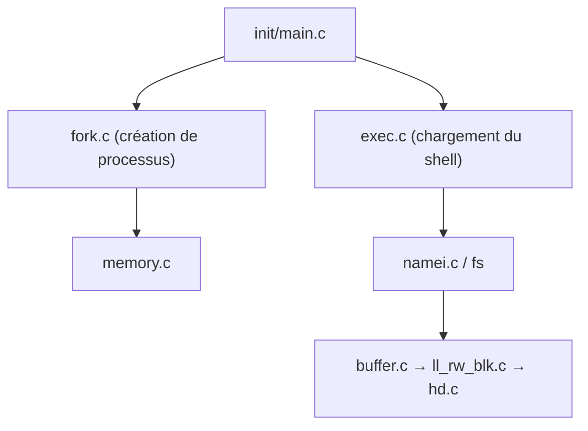

# dibingfa/flash-linux0.11-talk

> Série d'articles en chinois qui commente le code du noyau Linux 0.11, du démarrage à l'exécution d'une commande.

## Le problème
Le code d'un noyau de système d'exploitation est difficile à aborder sans guide.

## Ce que ça fait vraiment
Une table des matières de 48 chapitres en cinq parties : préparation avant le noyau, initialisation (mémoire, interruptions, disque, console), naissance d'un processus (fork), démarrage du shell, puis exécution d'une commande (lecture disque, signaux). L'architecture décrite relie init/main.c à fork.c, exec.c, namei.c et aux pilotes de disque.

## Comment c'est branché

## Essayer
Aucune commande documentée : lire les articles dans l'ordre depuis l'« Opening ».

## Coût et pièges
Gratuit à lire, sans licence déclarée. Articles en chinois uniquement. Dernier push en mars 2025. Une version livre (« Linux 源码趣读 ») est vendue séparément.

## Ce que ce n'est pas
Pas un cours sur le Linux actuel : c'est la version 0.11 (1991). Pas d'outil à exécuter.

## Alternatives
Aucune alternative nommée dans le README.

## Pour toi
À ignorer : du contenu d'apprentissage des systèmes en chinois, sans lien avec un travail data, IA ou MLOps.

