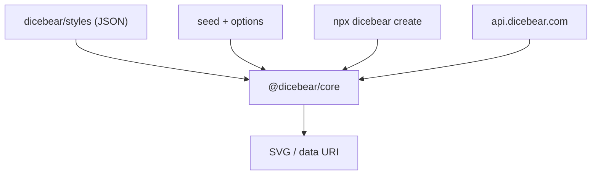

# dicebear/dicebear

> Library that turns a string (username, e-mail) into a reproducible SVG avatar, in seven languages.

## The problem
Give every user a profile picture without asking them to upload a photo or storing images.

## What it actually does
From a seed, generates an SVG from 63 styles defined in JSON; the same seed always yields the same byte-for-byte output across the seven ports (JavaScript, PHP, Python, Rust, Go, Dart, C#). A free HTTP API, a CLI and an editor also exist.

## How it is wired



## Trying it
```bash
npm install @dicebear/core
pip install dicebear-core
npx dicebear create lorelei -o ./avatars --count 10
```

## Cost and gotchas
Free, no account needed for the public API; self-hosting is possible with a Docker container. The public API sends the seed to a third-party server: host it yourself for privacy.

## What it is not
Not an AI image generator: these are fixed style definitions. The styles and the API live in other repositories.

## Alternatives
- dicebear/api: self-hostable version of the HTTP API, named in the README.

## For you
Worth watching: handy to illustrate a dashboard or a demo without image data, with no other value for modeling.
