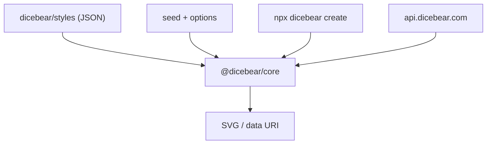

# dicebear/dicebear

> Bibliothèque qui transforme une chaîne (pseudo, e-mail) en avatar SVG reproductible, en sept langages.

## Le problème
Donner une image de profil à chaque utilisateur sans lui demander d'envoyer une photo ni stocker des images.

## Ce que ça fait vraiment
À partir d'une graine (seed), génère un SVG parmi 63 styles définis en JSON ; la même graine donne toujours le même octet de sortie dans les sept ports (JavaScript, PHP, Python, Rust, Go, Dart, C#). Une API HTTP gratuite, une CLI et un éditeur existent aussi.

## Comment c'est branché



## Essayer
```bash
npm install @dicebear/core
pip install dicebear-core
npx dicebear create lorelei -o ./avatars --count 10
```

## Coût et pièges
Gratuit, sans compte pour l'API publique ; auto-hébergement possible avec un conteneur Docker. L'API publique envoie la graine à un serveur tiers : à héberger soi-même pour la confidentialité.

## Ce que ce n'est pas
Pas un générateur d'images par IA : ce sont des définitions de styles fixes. Les styles et l'API vivent dans d'autres dépôts.

## Alternatives
- dicebear/api : version auto-hébergeable de l'API HTTP, nommée dans le README.

## Pour toi
À surveiller : pratique pour illustrer un tableau de bord ou une démo sans données d'image, sans autre intérêt pour la modélisation.

