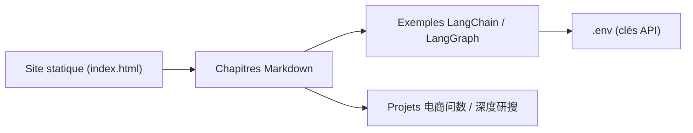

# didilili/ai-agents-from-zero

> Chinese-language tutorial for learning AI agents in Python: LangChain, LangGraph, RAG, MCP, projects.

## The problem
Content about agents is scattered; there is no continuous path from theory to complete projects.

## What it actually does
Course repository in Markdown (numbered chapters, static site) with folders of runnable examples (LangChain, LangGraph, Coze/Dify) and two projects: "电商问数" (NL2SQL with MySQL, Qdrant, Elasticsearch, LangGraph, FastAPI) and "深度研搜" (DeepAgents multi-agent). It also covers fine-tuning (LoRA, LLaMA-Factory) and an interview question bank. The full code of the two projects is in external repositories.

## How it is wired


## Trying it
```bash
git clone https://github.com/didilili/ai-agents-from-zero.git
cd ai-agents-from-zero
python3.10 -m venv .venv
source .venv/bin/activate
pip install -r requirements.txt
python 案例与源码-2-LangChain框架/01-helloworld/StandardDesc.py
```

## Cost and gotchas
Provider API keys (Qwen, DeepSeek...) at your expense, or Ollama locally. Run from the root, otherwise `.env` is not found.

## What it is not
Not an application nor a library. Content in Chinese. The README says it is inspired by a commercial course (Shangguigu).

## Alternatives
No alternative named in the README.

## For you
Worth watching: a good structured path if you read Chinese and want to build skills in LangGraph and RAG, otherwise the language barrier makes it of little use.
