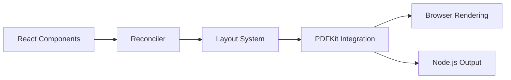

# diegomura/react-pdf

> Library to create PDFs with React components, in the browser or under Node.

## The problem
Generating PDFs (reports, invoices) often requires a separate engine and a template unrelated to the rest of the React code.

## What it actually does
You write `Document`, `Page`, `View`, `Text` components with flexbox-like styles, then render them: `PDFViewer` in the DOM, or `ReactPDF.render` to a file under Node. From the graph: a React reconciler, a layout engine (Yoga), PDFKit for writing, and font and image handling.

## How it is wired


## Trying it
```bash
yarn add @react-pdf/renderer
```
```jsx
import ReactPDF from '@react-pdf/renderer';
ReactPDF.render(<MyDocument />, `${__dirname}/example.pdf`);
```

## Cost and gotchas
Free. 327 open issues. The README is short: many features (fonts, SVG, images) are not detailed here.

## What it is not
Not a PDF reader: the README points to `react-pdf` for displaying existing PDFs.

## Alternatives
No alternative named in the README.

## For you
Adopt if you produce PDF reports from a React app; otherwise useless on the Python pipeline side.
