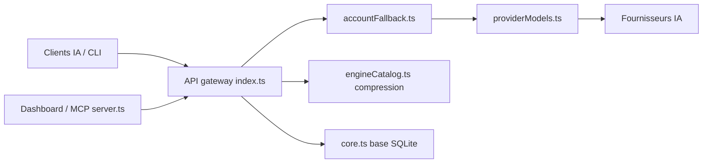

# diegosouzapw/OmniRoute

> A local gateway compatible with OpenAI that routes your requests between hundreds of LLM providers, with automatic fallback.

## The problem
Combining free tiers and subscriptions requires careful tracking of SDKs and rate limits.

## What it actually does
A single entry point `/v1`: either the `auto` model or "combos" (20 strategies: priority, round-robin, cost, quota, etc.), which switches when a quota is exhausted or a provider fails. Includes 12 context compression engines, memory, dashboard, CLI, MCP, and A2A. Advertised catalog: 375 providers, including free tiers that can be opened with your own accounts.

## How it is wired


## Trying it
```bash
npm install -g omniroute
omniroute
curl http://localhost:20128/v1/models -H "Authorization: Bearer YOUR_KEY"
```
Dashboard at `http://localhost:20128`.

## Cost and gotchas
Required supplier keys or accounts; some free tiers require identification or a card. Docker: allocate 8-12 GB of V8 heap for code agents. Suppliers marked with `tos: avoid` are excluded from `auto` by default.

## What it is not
Not simply free tokens: the figure "～1.62 billion/month" represents an aggregate of various tiers, which fluctuate. This is a significant undertaking: a very broad scope (compression, MITM/TPROXY, plugins) and 472 open issues.

## Alternatives
- LiteLLM: A recognized reference platform, with pricing and standardization provided by suppliers.
- OpenRouter: A hosted aggregator, as described in the README.
- CLIProxyAPI: A Go project that is a port of OmniRoute.

## For you
Monitoring: Useful for testing multiple models behind a single URL, but the large footprint and the risk of vendor-specific usage terms are drawbacks; LiteLLM remains a more streamlined option for MLOps.
