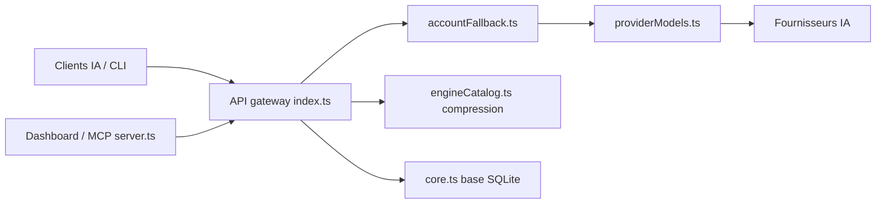

# diegosouzapw/OmniRoute

> Une passerelle locale compatible OpenAI qui route tes requêtes entre des centaines de fournisseurs LLM, avec repli automatique.

## Le problème
Cumuler des paliers gratuits et des abonnements demande autant de SDK et de limites de débit à suivre à la main.

## Ce que ça fait vraiment
Un point d'entrée `/v1` unique : modèle `auto` ou « combos » (20 stratégies : priorité, round-robin, coût, quota…), bascule quand un quota s'épuise ou un fournisseur tombe. Ajoute 12 moteurs de compression de contexte, mémoire, tableau de bord, CLI, MCP et A2A. Catalogue annoncé : 375 fournisseurs, dont des paliers gratuits à ouvrir avec tes propres comptes.

## Comment c'est branché


## Essayer
```bash
npm install -g omniroute
omniroute
curl http://localhost:20128/v1/models -H "Authorization: Bearer YOUR_KEY"
```
Dashboard sur `http://localhost:20128`.

## Coût et pièges
Clés ou comptes fournisseurs obligatoires ; certains paliers gratuits exigent identité ou carte. Docker : prévoir 8 à 12 Go de tas V8 pour des agents de code. Fournisseurs marqués `tos: avoid` exclus d'`auto` par défaut.

## Ce que ce n'est pas
Pas des jetons offerts : le chiffre « ~1,62 Md/mois » est un agrégat de paliers tiers qui changent. Pas léger : très large périmètre (compression, MITM/TPROXY, plugins) et 472 issues ouvertes.

## Alternatives
- LiteLLM : passerelle de référence citée, tarifs et normalisation des fournisseurs.
- OpenRouter : agrégateur hébergé comparé dans le README.
- CLIProxyAPI : projet Go dont OmniRoute est un portage.

## Pour toi
Surveiller : utile pour tester plusieurs modèles derrière une seule URL, mais la surface énorme et le risque de conditions d'usage fournisseurs pèsent ; LiteLLM reste plus sobre pour du MLOps.

