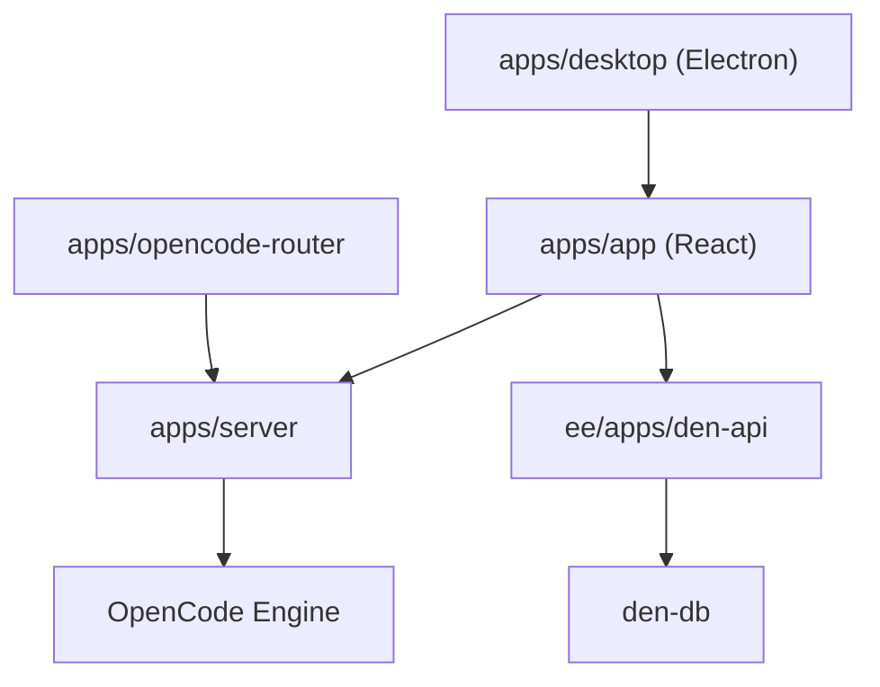

# different-ai/openwork

> Desktop application where AI agents work on your files, an open alternative to Claude Cowork.

## The problem
Desktop agents are tied to one model provider and share skills and MCP servers poorly across a team.

## What it actually does
Electron application built on OpenCode, with 50+ providers, personal keys or local models via Ollama. A remote MCP server exposes four tools (`search_capabilities`, `execute_capability`, `list_skills`, `get_skill`) to Codex, Claude Code or Cursor. An enterprise control plane (Den) manages access, policies and marketplace.

## How it is wired


## Trying it
```bash
git clone https://github.com/different-ai/openwork.git
cd openwork
corepack enable
pnpm install
pnpm dev
```

## Cost and gotchas
Node 24 and pnpm 11 required. API keys or local models at your expense. The hosted MCP (api.openworklabs.com) requires a browser login.

## What it is not
Not entirely MIT: the `ee/` folder (Den) is under a source-available license; production use is paid beyond 5 users.

## Alternatives
Claude Cowork and Codex, cited as the products it is the open alternative to.

## For you
Worth watching: useful for sharing skills and MCP across agents, but a very young repository (2026-01), with a mixed license and a broad scope.
