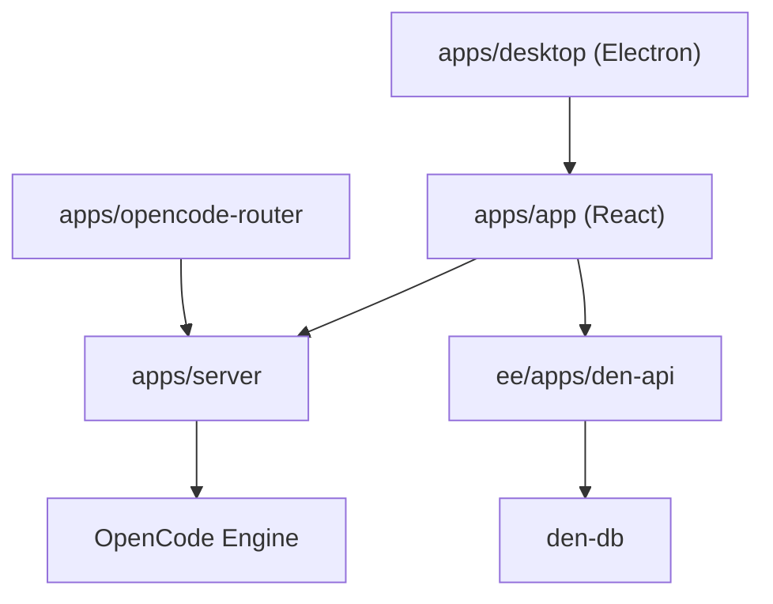

# different-ai/openwork

> Application de bureau où des agents IA travaillent sur tes fichiers, alternative libre à Claude Cowork.

## Le problème
Les agents de bureau sont liés à un fournisseur de modèle et partagent mal skills et serveurs MCP en équipe.

## Ce que ça fait vraiment
Application Electron construite sur OpenCode, avec 50+ fournisseurs, clés perso ou modèles locaux via Ollama. Un serveur MCP distant expose quatre outils (`search_capabilities`, `execute_capability`, `list_skills`, `get_skill`) à Codex, Claude Code ou Cursor. Un plan de contrôle d'entreprise (Den) gère accès, politiques et marketplace.

## Comment c'est branché


## Essayer
```bash
git clone https://github.com/different-ai/openwork.git
cd openwork
corepack enable
pnpm install
pnpm dev
```

## Coût et pièges
Node 24 et pnpm 11 requis. Clés API ou modèles locaux à ta charge. Le MCP hébergé (api.openworklabs.com) demande une connexion navigateur.

## Ce que ce n'est pas
Pas entièrement MIT : le dossier `ee/` (Den) est sous licence source-available ; usage en production payant au-delà de 5 utilisateurs.

## Alternatives
Claude Cowork et Codex, cités comme les produits dont il est l'alternative libre.

## Pour toi
À surveiller : utile pour mutualiser skills et MCP entre agents, mais dépôt très jeune (2026-01), à licence mixte et au périmètre large.

