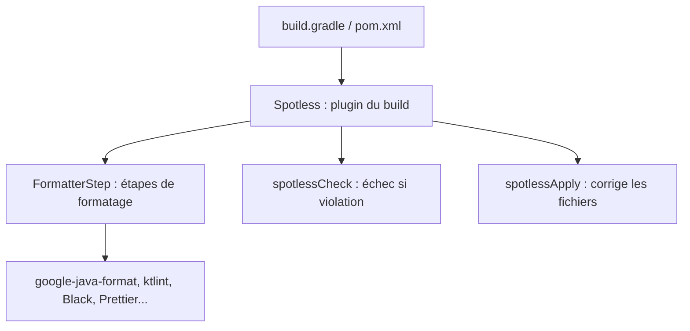

# diffplug/spotless

> Multi-language code formatter plugged into Gradle, Maven or sbt, for teams that want a single style.

## The problem
Each developer formats in their own way: diffs get polluted with whitespace and indentation, and code review wastes time on style.

## What it actually does
Spotless runs inside the build: `check` fails if files do not respect the format, `apply` fixes them. It covers a long list of languages (Java, Kotlin, Python via Black, SQL, JSON, Markdown, YAML, shell…) relying on dedicated formatting steps. It offers an idempotence safeguard and a "ratchet" mode that only reformats what has changed since a git reference. The feature matrix is more complete for Gradle than for Maven, and reduced for sbt.

## How it is wired

Simplified diagram based on the sheet, no diagram provided.

## Trying it
```bash
./gradlew build
./gradlew spotlessApply
mvn spotless:check
mvn spotless:apply
```

## Cost and gotchas
Free. You need a Gradle, Maven or sbt build: the JVM environment is the real requirement, not Python. sbt support is external and partial, and several steps are only available for a single build tool (empty cells in the matrix).

## What it is not
Not a linter that analyzes logic: it only reformats the form. Not a standalone command-line tool: it lives in the build. The README mostly shows a matrix and points to the plugins' documentation for usage.

## Alternatives
No alternative named in the README.

## For you
Keep an eye on it: only useful if your projects go through Gradle or Maven, otherwise a native formatter for your language (Python, for example) will be more direct.
