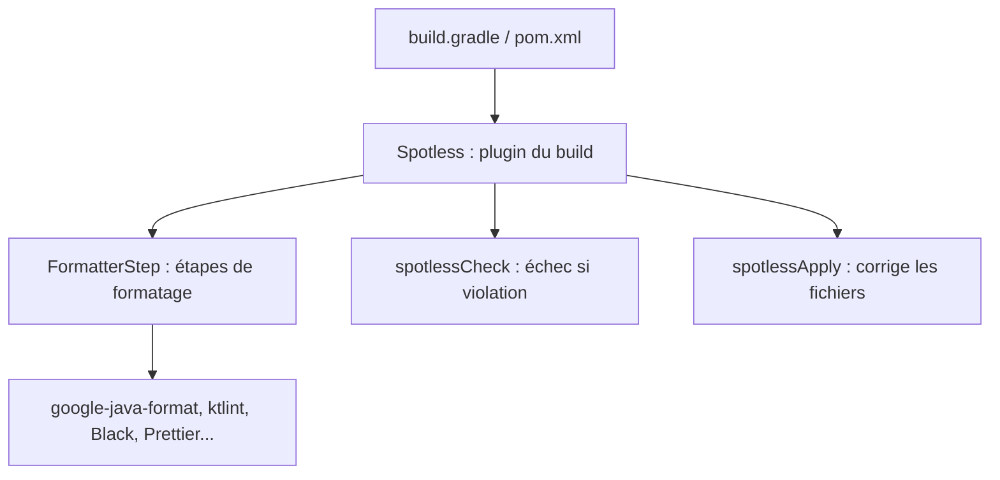

# diffplug/spotless

> Formateur de code multi-langages branché sur Gradle, Maven ou sbt, pour les équipes qui veulent un style unique.

## Le problème
Chaque développeur formate à sa façon : les diffs se polluent d'espaces et d'indentations, et la revue de code perd du temps sur le style.

## Ce que ça fait vraiment
Spotless s'exécute dans le build : `check` échoue si des fichiers ne respectent pas le format, `apply` les corrige. Il couvre une longue liste de langages (Java, Kotlin, Python via Black, SQL, JSON, Markdown, YAML, shell…) en s'appuyant sur des étapes de formatage dédiées. Il propose un garde-fou d'idempotence et un mode « ratchet » qui ne reformate que ce qui a changé depuis une référence git. La matrice des fonctions est plus complète pour Gradle que pour Maven, et réduite pour sbt.

## Comment c'est branché

Schéma simplifié d'après la fiche, sans diagramme fourni.

## Essayer
```bash
./gradlew build
./gradlew spotlessApply
mvn spotless:check
mvn spotless:apply
```

## Coût et pièges
Gratuit. Il faut un build Gradle, Maven ou sbt : l'environnement JVM est le vrai besoin, pas Python. Le support sbt est externe et partiel, et plusieurs étapes ne sont disponibles que pour un seul outil de build (cases vides de la matrice).

## Ce que ce n'est pas
Ce n'est pas un linter qui analyse la logique : il ne reformate que la forme. Ce n'est pas un outil autonome en ligne de commande : il vit dans le build. Le README affiche surtout une matrice et renvoie vers la documentation des plugins pour l'usage.

## Alternatives
Aucune alternative nommée dans le README.

## Pour toi
À surveiller : utile seulement si tes projets passent par Gradle ou Maven, sinon un formateur natif de ton langage (Python, par exemple) sera plus direct.

