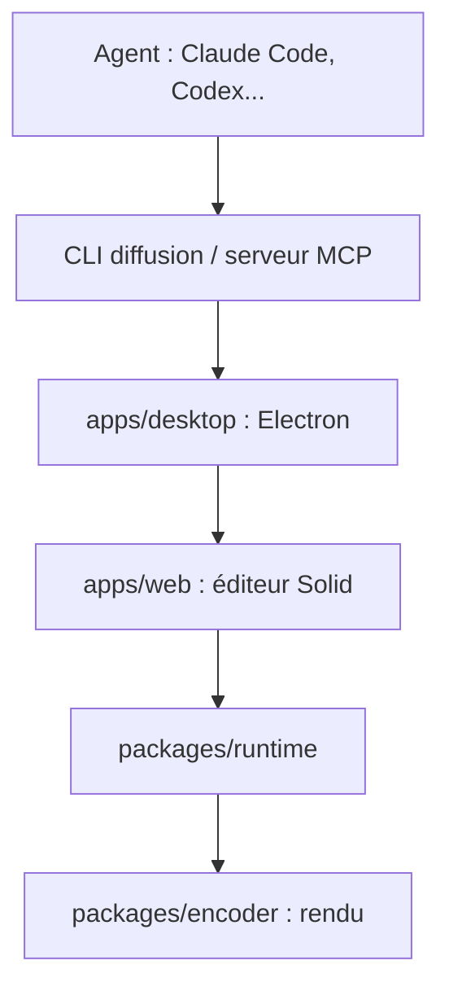

# diffusionstudio/editor

> Desktop video editor driven by coding agents; each edit is written in SolidJS JSX.

## The problem
Having an agent edit a video without it being able to see or hear the media, and without the human easily taking back control.

## What it actually does
The project is a folder of JSX: changing the canvas updates the code, and vice versa. The application exposes tools (`probe`, `grab`, `transcribe`, `listen`, `capture`) over MCP and on the command line to inspect media. Agents cut, caption, color-grade and render.

## How it is wired


## Trying it
```bash
npx skills add diffusionstudio/skills
diffusion open
diffusion probe clip.mp4
diffusion transcribe interview.wav
```

## Cost and gotchas
macOS (Apple Silicon) and Windows (x64) application only. Agents use your own subscriptions or keys; `listen` calls a multimodal model.

## What it is not
Not an editing library to import, nor an online service. File-level MPL-2.0 license: modifications to MPL files must remain open.

## Alternatives
No alternative named in the README (only diffusionstudio/open-projects is cited, for examples).

## For you
Worth watching: a clear demonstration of an "agent-readable" editor, useful as a model, but outside common data/MLOps needs.
