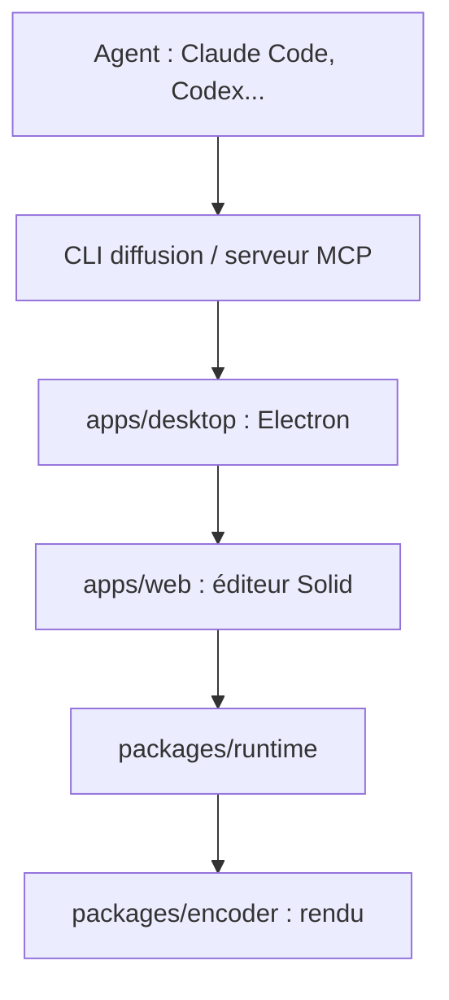

# diffusionstudio/editor

> Éditeur vidéo de bureau que pilotent des agents de code ; chaque montage s'écrit en JSX SolidJS.

## Le problème
Faire monter une vidéo par un agent sans qu'il puisse voir ni entendre les médias, ni que l'humain reprenne la main facilement.

## Ce que ça fait vraiment
Le projet est un dossier de JSX : modifier le canevas met le code à jour, et inversement. L'application expose en MCP et en ligne de commande des outils (`probe`, `grab`, `transcribe`, `listen`, `capture`) pour inspecter les médias. Les agents coupent, sous-titrent, étalonnent et rendent.

## Comment c'est branché


## Essayer
```bash
npx skills add diffusionstudio/skills
diffusion open
diffusion probe clip.mp4
diffusion transcribe interview.wav
```

## Coût et pièges
Application macOS (Apple Silicon) et Windows (x64) seulement. Les agents consomment vos propres abonnements ou clés ; `listen` appelle un modèle multimodal.

## Ce que ce n'est pas
Pas une bibliothèque de montage à importer, ni un service en ligne. Licence MPL-2.0 à fichiers : les modifications des fichiers MPL doivent rester ouvertes.

## Alternatives
Aucune alternative nommée dans le README (seul diffusionstudio/open-projects est cité, pour des exemples).

## Pour toi
À surveiller : démonstration nette d'un éditeur « lisible par agent », utile comme modèle, mais hors des besoins data/MLOps courants.

