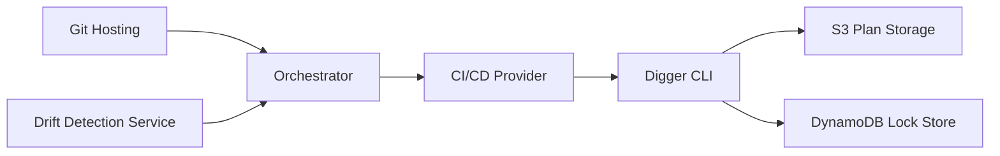

# diggerhq/digger

> Terraform automation in pull requests, run by your existing CI rather than a dedicated server.

## The problem
Specialized Terraform platforms duplicate the CI, cost compute and receive your cloud secrets.

## What it actually does
A CLI runs in your CI and calls Terraform; a minimal orchestrator triggers jobs on events (PR comments). Plan/apply via PR comments, per-PR locks, OPA for RBAC, Terragrunt, drift detection, plan persistence. Locks and plan cache go into your cloud account (DynamoDB and S3 on AWS).

## How it is wired


## Trying it
```bash
atlas migrate apply --url $DATABASE_URL --allow-dirty
```
This command comes from the migrations section; the getting-started guides (GitHub Actions + AWS or GCP) are in the documentation.

## Cost and gotchas
Anonymized telemetry, which can be disabled via `telemetry: false` or `TELEMETRY=false`. The project has been renamed OpenTaco since November 2025. About 490 open issues.

## What it is not
Not an ML tool: it concerns infrastructure. Not a service you are required to host, but the orchestrator is required.

## Alternatives
- Atlantis: requires hosting a server.
- Terraform Cloud, Spacelift: third-party platforms that run the code on their side.

## For you
Worth watching: relevant if you industrialize your ML platform's infrastructure in Terraform, otherwise out of scope.
