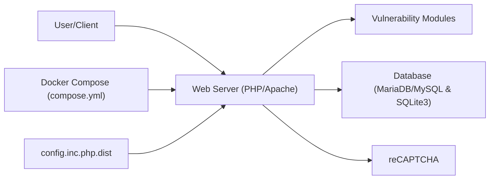

# digininja/DVWA

> Deliberately vulnerable PHP/MariaDB web application, for practicing web security in a controlled environment.

## The problem
Practicing common web flaws (SQLi, XSS, CSRF...) requires a legal target, without touching a real site.

## What it actually does
A monolithic PHP app under Apache exposes vulnerability modules at several difficulty levels, with a MariaDB/MySQL database, or SQLite for SQLi. It ships with Docker Compose (port 4280) and an authentication-free mode. Some flaws are documented, others are hidden on purpose.

## How it is wired


## Trying it
```bash
git clone https://github.com/digininja/DVWA.git
cd DVWA
docker compose up -d
# puis http://localhost:4280  (admin / password)
```

## Cost and gotchas
Free. Never expose it on the Internet: it is made to be compromised. Default credentials `admin`/`password`. The automatic install script is third-party and requires root rights.

## What it is not
Not a security tool nor a scanner: it is a target. Vulnerability reports are rejected, since the flaws are intentional.

## Alternatives
No alternative named in the README.

## For you
Worth watching: useful for testing a scanner or training a team, outside the data/AI core; keep it on the local network.
