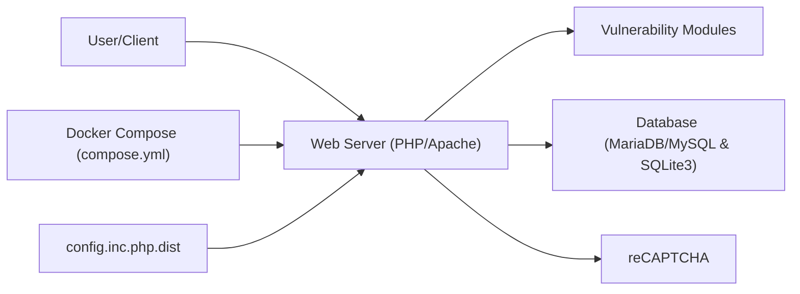

# digininja/DVWA

> Application web PHP/MariaDB volontairement vulnérable, pour s'entraîner à la sécurité web en environnement contrôlé.

## Le problème
S'exercer aux failles web courantes (SQLi, XSS, CSRF…) demande une cible légale, sans toucher un vrai site.

## Ce que ça fait vraiment
Une appli PHP monolithique sous Apache expose des modules de vulnérabilités à plusieurs niveaux de difficulté, avec une base MariaDB/MySQL, ou SQLite pour le SQLi. Elle est livrée avec Docker Compose (port 4280) et un mode sans authentification. Certaines failles sont documentées, d'autres cachées exprès.

## Comment c'est branché


## Essayer
```bash
git clone https://github.com/digininja/DVWA.git
cd DVWA
docker compose up -d
# puis http://localhost:4280  (admin / password)
```

## Coût et pièges
Gratuit. Ne jamais l'exposer sur Internet : il est fait pour être compromis. Identifiants par défaut `admin`/`password`. Le script d'install automatique est tiers et demande les droits root.

## Ce que ce n'est pas
Pas un outil de sécurité ni un scanner : c'est une cible. Les rapports de vulnérabilités sont refusés, car elles sont volontaires.

## Alternatives
Aucune alternative nommée dans le README.

## Pour toi
À surveiller : utile pour tester un scanner ou former une équipe, hors du cœur de métier data/IA ; garde-le en réseau local.

