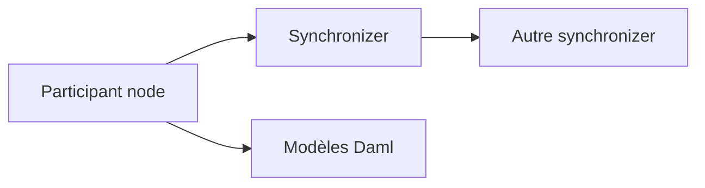

# digital-asset/canton

> Daml ledger interoperability protocol with privacy and authorizations, by Digital Asset.

## The problem
Conventional distributed ledgers struggle to reconcile privacy, scalability and the right to be forgotten.

## What it actually does
Partitions the global state; authentication and transport go through synchronizers that can be deployed at will, permissioned but federable. The README presents it as suited to GDPR-compliant systems. Operation is documented elsewhere.

## How it is wired

## Trying it
No command documented; see the external documentation.

## Cost and gotchas
Free; demanding to implement, details not in this README.

## What it is not
Neither a public blockchain nor a lightweight library.

## Alternatives
No alternative named in the README.

## For you
Ignore: distributed ledger with no link to data/AI/MLOps.
