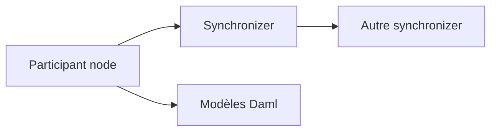

# digital-asset/canton

> Protocole d'interopérabilité de registres Daml avec confidentialité et autorisations, par Digital Asset.

## Le problème
Les registres distribués classiques peinent à concilier confidentialité, passage à l'échelle et droit à l'oubli.

## Ce que ça fait vraiment
Partitionne l'état global ; l'authentification et le transport passent par des synchronizers déployables à volonté, permissionnés mais fédérables. Le README le présente comme adapté à des systèmes conformes RGPD. Opération documentée ailleurs.

## Comment c'est branché

## Essayer
Aucune commande documentée ; voir la documentation externe.

## Coût et pièges
Gratuit ; mise en oeuvre exigeante, détails non dans ce README.

## Ce que ce n'est pas
Ni une blockchain publique ni une bibliothèque légère.

## Alternatives
Aucune alternative nommée dans le README.

## Pour toi
À ignorer : registre distribué sans lien avec data/IA/MLOps.

