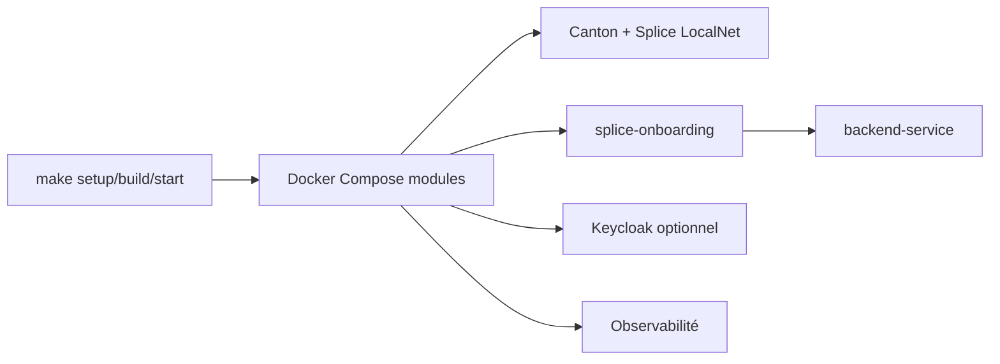

# digital-asset/cn-quickstart

> Skeleton for developing a Canton Network application on the Global Synchronizer, for Daml developers.

## The problem
Setting up a local Canton, Splice, authentication and observability environment is long and complex.

## What it actually does
Orchestrates via modular Docker Compose: Canton participants, Splice LocalNet, optional Keycloak (OAuth2), PQS, Postgres, observability (Grafana, Prometheus, Loki, Tempo), Daml Shell. A license-management demo application with a Spring Boot backend and a frontend. `make` targets drive everything. The README assumes a Daml Enterprise license to take advantage of all features.

## How it is wired


## Trying it
```bash
direnv allow
cd quickstart
make setup
make build
make start
make canton-console
```

## Cost and gotchas
Free, but a Daml Enterprise license is assumed for the full features. At least 8 GB of memory allocated to Docker. The README describes the project as a work in progress that evolves quickly; a `make clean-all` may be required after an update.

## What it is not
Not a production product: the initialization component is not intended for production, nor is the default configuration.

## Alternatives
Splice LocalNet (the base on which the project is built).

## For you
Ignore: Canton/Daml blockchain stack outside the data, AI or MLOps scope, unless you have a specific assignment on this network.
