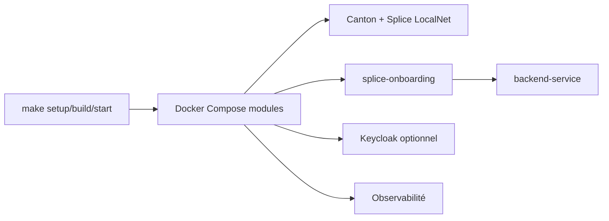

# digital-asset/cn-quickstart

> Squelette pour développer une application Canton Network sur le Global Synchronizer, pour développeurs Daml.

## Le problème
Monter un environnement local Canton, Splice, authentification et observabilité est long et complexe.

## Ce que ça fait vraiment
Orchestre via Docker Compose modulaire : participants Canton, Splice LocalNet, Keycloak (OAuth2) optionnel, PQS, Postgres, observabilité (Grafana, Prometheus, Loki, Tempo), Daml Shell. Application de démonstration de licences avec backend Spring Boot et frontend. Cibles `make` pour tout piloter. Le README suppose une licence Daml Enterprise pour tirer parti de toutes les fonctions.

## Comment c'est branché


## Essayer
```bash
direnv allow
cd quickstart
make setup
make build
make start
make canton-console
```

## Coût et pièges
Gratuit, mais licence Daml Enterprise supposée pour les fonctions complètes. Au moins 8 Go de mémoire alloués à Docker. Le README décrit le projet comme un travail en cours rapide à évoluer ; un `make clean-all` peut être requis après mise à jour.

## Ce que ce n'est pas
Pas un produit de production : le composant d'initialisation n'est pas prévu pour la production, ni la configuration par défaut.

## Alternatives
Splice LocalNet (base sur laquelle le projet est construit).

## Pour toi
À ignorer : stack blockchain Canton/Daml hors du périmètre data, IA ou MLOps, sauf mission précise sur ce réseau.

