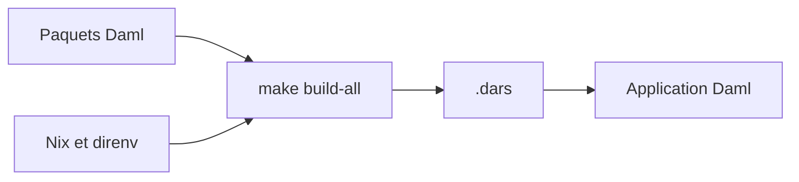

# digital-asset/daml-finance

> Daml libraries of financial building blocks for building enterprise tokenization solutions.

## The problem
Modelling the ownership and economic terms of an asset is complex and repetitive.

## What it actually does
A collection of Daml packages providing basic blocks for tokenization applications, with a demo application and documentation. The build produces one DAR file per package in `.dars`.

## How it is wired
Simplified diagram based on the fiche, no diagram provided.



## Trying it
```bash
make build-all
make ci-local
```

## Cost and gotchas
Free. Requires Nix and direnv. README warning: repository not maintained, no guarantee of fixes or compatibility with new Daml SDKs.

## What it is not
Not a maintained product: the README says so explicitly. No link to ML.

## Alternatives
No alternative named in the README.

## For you
Ignore: finance on Daml, unmaintained, outside your scope.
