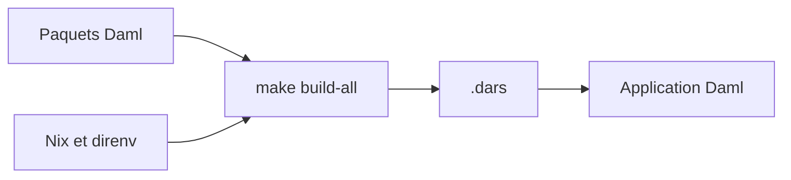

# digital-asset/daml-finance

> Bibliothèques Daml de briques financières pour construire des solutions de tokenisation d'entreprise.

## Le problème
Modéliser propriété et conditions économiques d'un actif est complexe et répétitif.

## Ce que ça fait vraiment
Collection de paquets Daml fournissant des blocs de base pour applications de tokenisation, avec une application de démonstration et une documentation. Le build produit un fichier DAR par paquet dans `.dars`.

## Comment c'est branché
Schéma simplifié d'après la fiche, sans diagramme fourni.



## Essayer
```bash
make build-all
make ci-local
```

## Coût et pièges
Gratuit. Exige Nix et direnv. Avertissement du README : dépôt non maintenu, sans garantie de correctifs ni de compatibilité avec les nouveaux SDK Daml.

## Ce que ce n'est pas
Pas un produit maintenu : le README le dit explicitement. Pas de lien avec le ML.

## Alternatives
Aucune alternative nommée dans le README.

## Pour toi
À ignorer : finance sur Daml, non maintenu, hors de ton périmètre.

