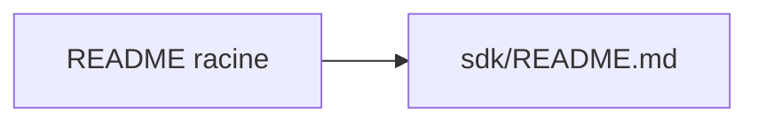

# digital-asset/daml

> Digital Asset's Daml development kit; the repository README is reduced to a pointer.

## The problem
Not documented in this README, which points to `sdk/README.md`.

## What it actually does
The only content read is "See full README at sdk/README.md". The referenced file was not provided: no function can be deduced.

## How it is wired

## Trying it
No command documented.

## Cost and gotchas
Not documented. 751 open issues.

## What it is not
Nothing more to say without reading sdk/README.md: a fuller sheet requires that file.

## Alternatives
No alternative named in the README.

## For you
Ignore for lack of information: the README does not allow judging any link with data / AI / MLOps.
