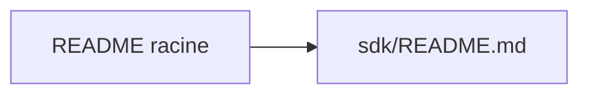

# digital-asset/daml

> Kit de développement Daml de Digital Asset ; README du dépôt réduit à un renvoi.

## Le problème
Non documenté dans ce README, qui renvoie à `sdk/README.md`.

## Ce que ça fait vraiment
Le seul contenu lu est « See full README at sdk/README.md ». Le fichier cité n'a pas été fourni : aucune fonction n'est déductible.

## Comment c'est branché

## Essayer
Aucune commande documentée.

## Coût et pièges
Non documenté. 751 issues ouvertes.

## Ce que ce n'est pas
Rien de plus à dire sans lire sdk/README.md : une fiche plus complète demande ce fichier.

## Alternatives
Aucune alternative nommée dans le README.

## Pour toi
À ignorer faute d'information : le README ne permet pas de juger un lien avec data / IA / MLOps.

