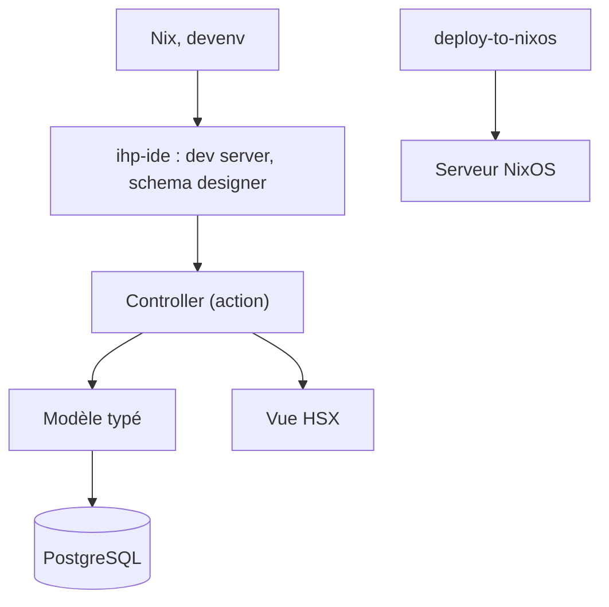

# digitallyinduced/ihp

> Typed Haskell web framework, with Nix, for teams building durable web applications.

## The problem
Routing, query or HTML errors often show up at runtime, and development environments diverge from one workstation to another.

## What it actually does
IHP offers typed routing, queries and HTML (HSX), a visual schema designer, code generators, live reloading and automatic view refresh. Nix provides the dependencies (GHC, PostgreSQL) via `devenv up`. The repository also contains packages for WebSocket synchronization, GraphQL, jobs and OpenAI integration. Deployment to NixOS goes through `deploy-to-nixos`.

## How it is wired
Simplified schema based on the sheet, no diagram supplied.


## Trying it
```bash
nix profile install nixpkgs#ihp-new
ihp-new myproject
cd myproject && devenv up
deploy-to-nixos production
```

## Cost and gotchas
Free. Nix is required, and the Haskell stack imposes a learning curve. The targeted deployment is NixOS, with Docker and bare-metal also supported.

## What it is not
Not a data science or AI framework: the `ihp-openai` package is only an integration. It is not a tool for an audience without Haskell.

## Alternatives
No alternative named in the README.

## For you
Ignore: a Haskell web framework outside your data/AI/MLOps stack, unless you want to learn Haskell and Nix.
