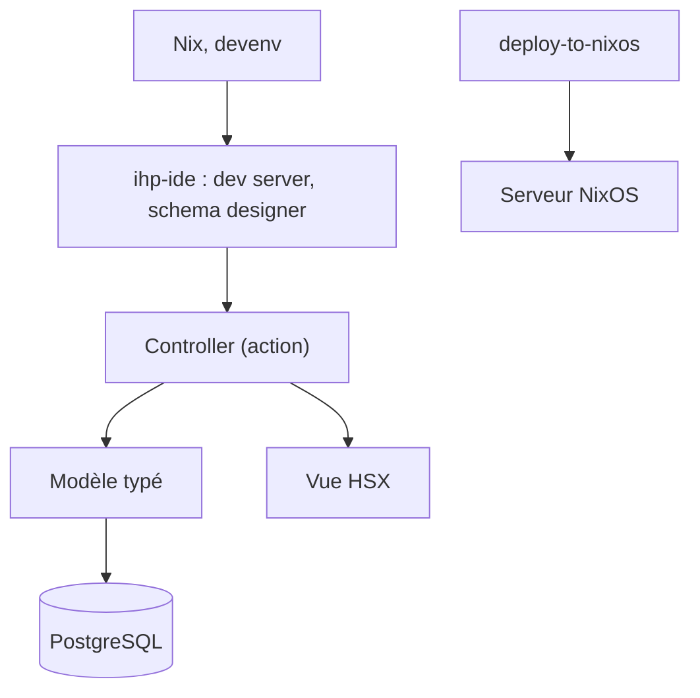

# digitallyinduced/ihp

> Framework web Haskell typé, avec Nix, pour équipes qui construisent des applications web durables.

## Le problème
Les erreurs de routage, de requêtes ou de HTML apparaissent souvent à l'exécution, et les environnements de développement divergent d'un poste à l'autre.

## Ce que ça fait vraiment
IHP offre routage, requêtes et HTML (HSX) typés, un concepteur de schéma visuel, des générateurs de code, le rechargement en direct et l'actualisation automatique des vues. Nix fournit les dépendances (GHC, PostgreSQL) via `devenv up`. Le dépôt contient aussi des paquets de synchronisation par WebSocket, GraphQL, jobs et intégration OpenAI. Le déploiement vers NixOS passe par `deploy-to-nixos`.

## Comment c'est branché
Schéma simplifié d'après la fiche, sans diagramme fourni.


## Essayer
```bash
nix profile install nixpkgs#ihp-new
ihp-new myproject
cd myproject && devenv up
deploy-to-nixos production
```

## Coût et pièges
Gratuit. Il faut Nix, et la pile Haskell impose une courbe d'apprentissage. Le déploiement visé est NixOS, Docker et bare-metal étant aussi supportés.

## Ce que ce n'est pas
Pas un framework de data science ni d'IA : le paquet `ihp-openai` n'est qu'une intégration. Ce n'est pas un outil pour un public sans Haskell.

## Alternatives
Aucune alternative nommée dans le README.

## Pour toi
À ignorer : un framework web Haskell hors de ta pile data/IA/MLOps, sauf envie d'apprendre Haskell et Nix.

