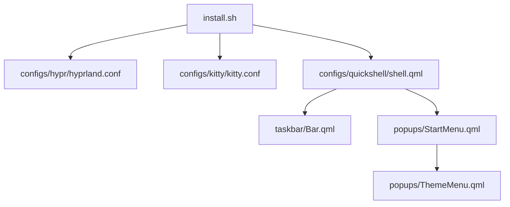

# diinki/linux-retroism

> 1980s-1990s style Linux desktop theme, under Hyprland or Sway, for customization enthusiasts.

## The problem
Customizing a Wayland desktop means assembling the bar, menus, themes and configurations yourself.

## What it actually does
install.sh copies the Hyprland, Sway, kitty and quickshell configurations, backing up the files it replaces. The quickshell shell loads the taskbar, the start menu and a theme menu that changes kitty's colors. GTK and icon themes are included, still rough.

## How it is wired


## Trying it
```bash
./install.sh
```
The GTK and icon themes must be moved by hand to `~/.local/share/themes` and `~/.local/share/icons`.

## Cost and gotchas
Free. Dependencies to install: Hyprland or SwayFX, quickshell, nemo, kitty, grim, mako, etc. The script replaces existing configurations, which are backed up. Sway has issues with NVIDIA GPUs.

## What it is not
A version 0.1: the v0.2 list admits a "janky" GTK theme, few icons and an incomplete settings menu. Not a proven work environment.

## Alternatives
No alternative cited in the README.

## For you
Ignore: desktop aesthetics, with no effect on data, AI or MLOps work.
