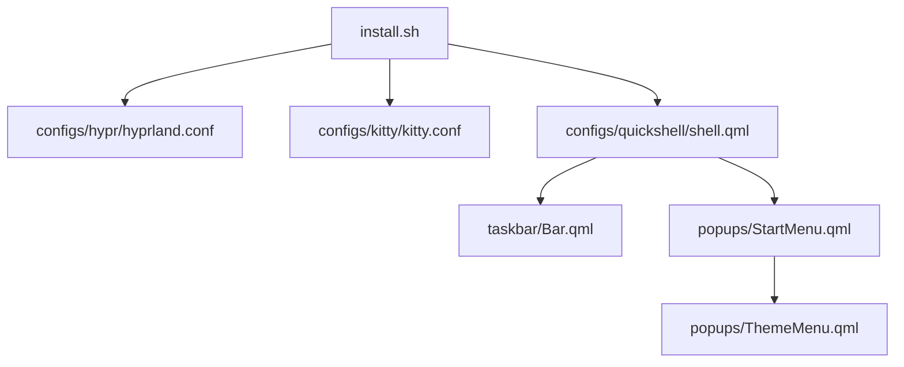

# diinki/linux-retroism

> Habillage de bureau Linux au style des années 1980-1990, sous Hyprland ou Sway, pour amateurs de personnalisation.

## Le problème
Personnaliser un bureau Wayland demande d'assembler soi-même barre, menus, thèmes et configurations.

## Ce que ça fait vraiment
install.sh copie les configurations Hyprland, Sway, kitty et quickshell, avec sauvegarde des fichiers remplacés. Le shell quickshell charge la barre des tâches, le menu démarrer et un menu de thèmes qui change les couleurs de kitty. Thèmes GTK et d'icônes inclus, encore bruts.

## Comment c'est branché


## Essayer
```bash
./install.sh
```
Les thèmes GTK et d'icônes se déplacent à la main vers `~/.local/share/themes` et `~/.local/share/icons`.

## Coût et pièges
Gratuit. Dépendances à installer : Hyprland ou SwayFX, quickshell, nemo, kitty, grim, mako, etc. Le script remplace des configurations existantes, sauvegardées. Sway pose des soucis avec les GPU NVIDIA.

## Ce que ce n'est pas
Une version 0.1 : la liste v0.2 admet un thème GTK « janky », peu d'icônes et un menu de réglages incomplet. Pas un environnement de travail éprouvé.

## Alternatives
Aucune alternative citée dans le README.

## Pour toi
Ignorer : de l'esthétique de bureau, sans effet sur un travail data, IA ou MLOps.

