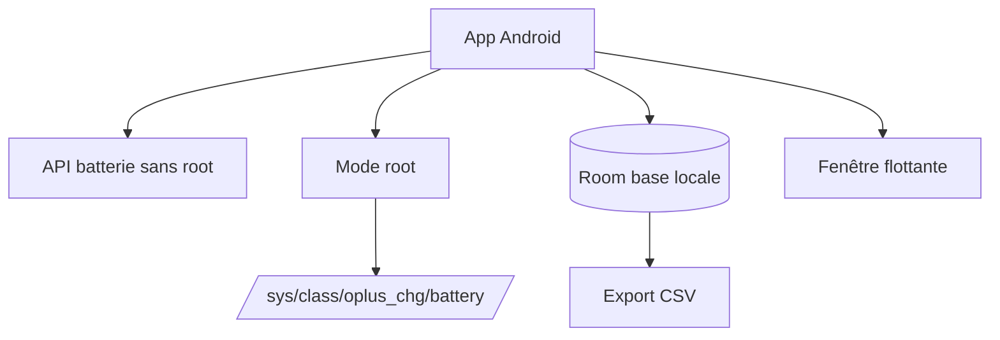

# dijia1124/PlusPlusBattery

> Android application that shows the battery status and health of OnePlus, Oppo and Realme devices.

## The problem
OPlus phones hide the real capacity and health of their battery, especially with compensated silicon-carbon batteries.

## What it actually does
Shows level, voltage, current and power without root, with charts. Estimates full-charge capacity and health at 100% charge. Keeps cycle history in a Room database with CSV export, and offers a floating window. Root mode reads `/sys/class/oplus_chg/battery/` files.

## How it is wired
Simplified diagram based on the sheet, no diagram provided.



## Trying it
```bash
# Pas de commande : installer l'APK depuis la page Releases ou F-Droid
# (com.dijia1124.plusplusbattery), puis lancer l'application
```

## Cost and gotchas
Free. Detailed data requires root. On ColorOS, you must disable battery optimization and enable auto-launch for monitoring.

## What it is not
The displayed health is an estimate, not a true measurement. It is not a tool for iPhone or for other brands beyond the limited universal mode.

## Alternatives
No alternative named in the README.

## For you
Ignore: consumer Android utility, unrelated to your data/AI/MLOps work.
