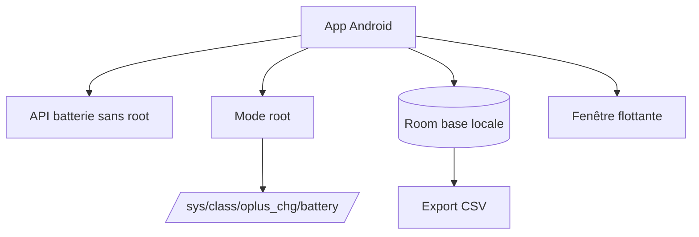

# dijia1124/PlusPlusBattery

> Application Android qui affiche l'état et la santé de la batterie des appareils OnePlus, Oppo et Realme.

## Le problème
Les téléphones OPlus cachent la capacité réelle et la santé de leur batterie, surtout avec les batteries silicium-carbone compensées.

## Ce que ça fait vraiment
Affiche niveau, tension, courant et puissance sans root, avec des graphiques. Estime la capacité pleine charge et la santé à 100 % de charge. Garde l'historique des cycles dans une base Room avec export CSV, et propose une fenêtre flottante. Le mode root lit des fichiers `/sys/class/oplus_chg/battery/`.

## Comment c'est branché
Schéma simplifié d'après la fiche, sans diagramme fourni.



## Essayer
```bash
# Pas de commande : installer l'APK depuis la page Releases ou F-Droid
# (com.dijia1124.plusplusbattery), puis lancer l'application
```

## Coût et pièges
Gratuit. Les données détaillées demandent le root. Sur ColorOS, il faut désactiver l'optimisation batterie et activer le lancement automatique pour la surveillance.

## Ce que ce n'est pas
La santé affichée est une estimation, pas une mesure vraie. Ce n'est pas un outil pour iPhone ni pour d'autres marques en dehors du mode universel limité.

## Alternatives
Aucune alternative nommée dans le README.

## Pour toi
À ignorer : utilitaire Android grand public, sans rapport avec ton métier data/IA/MLOps.

