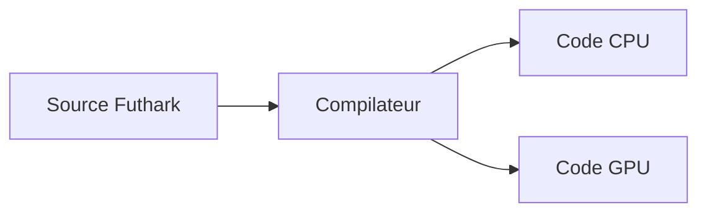

# diku-dk/futhark

> Pure functional, data-parallel language compiled to CPU or GPU code.

## The problem
Writing efficient parallel GPU code is slow and error-prone at a low level.

## What it actually does
- ML-family language, developed at the University of Copenhagen (DIKU).
- The compiler produces parallel code for CPU or GPU.
- The README calls it "fairly stable" for practical programming.
- Resources: examples, guide, the book "Parallel Programming in Futhark", libraries.

## How it is wired

## Trying it
No command documented in the README (it refers to the installation instructions on the website).

## Cost and gotchas
Free. A GPU is useful to benefit from it. Niche language: few libraries.

## What it is not
Not a Python GPU computing framework. You have to learn a new language.

## Alternatives
No alternative named in the README.

## For you
Worth watching if you write GPU compute kernels outside Python; otherwise the investment of a new language is heavy.
