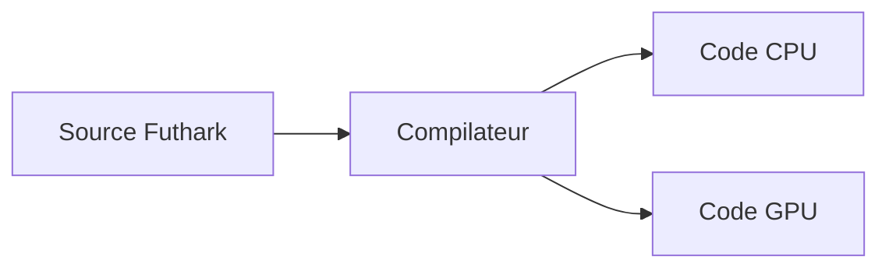

# diku-dk/futhark

> Langage fonctionnel pur, parallèle sur les données, compilé vers du code CPU ou GPU.

## Le problème
Écrire du code parallèle efficace pour GPU est long et sujet aux erreurs en bas niveau.

## Ce que ça fait vraiment
- Langage de la famille ML, développé à l'université de Copenhague (DIKU).
- Le compilateur produit du code parallèle pour CPU ou GPU.
- Le README le dit « assez stable » pour la programmation pratique.
- Ressources : exemples, guide, livre « Parallel Programming in Futhark », bibliothèques.

## Comment c'est branché

## Essayer
Aucune commande documentée dans le README (renvoi aux instructions d'installation du site).

## Coût et pièges
Gratuit. Un GPU est utile pour en tirer parti. Langage de niche : peu de bibliothèques.

## Ce que ce n'est pas
Pas un framework Python de calcul GPU. Il faut apprendre un nouveau langage.

## Alternatives
Aucune alternative nommée dans le README.

## Pour toi
À surveiller si tu écris des noyaux de calcul GPU hors Python ; sinon l'investissement d'un nouveau langage est lourd.

