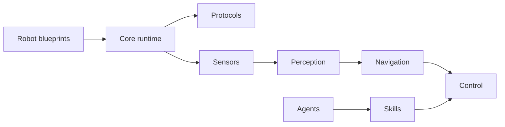

# dimensionalOS/dimos

> Python framework for driving quadruped robots, humanoids and drones, with LLM agents as a tool.

## The problem
Programming a robot means assembling sensors, mapping, navigation and control, often under ROS.

## What it actually does
Typed Python modules (stream inputs/outputs, RPC) are wired into "blueprints" by `autoconnect`, over LCM, shared memory, DDS, Zenoh or ROS 2 transports. The repo covers perception, mapping, navigation, manipulation, spatio-temporal memory and an MCP server for agents. MuJoCo simulation and session replay are available. Announced status: "pre-release beta".

## How it is wired


## Trying it
```bash
curl -fsSL https://raw.githubusercontent.com/dimensionalOS/dimos/main/scripts/install.sh | bash
dimos --replay run unitree-go2
dimos --simulation run unitree-go2
dimos agent-send "explore the room"
```

## Cost and gotchas
Installation via a downloaded script (read it first). Real hardware is expensive; replay and simulation avoid needing a robot. dimTELE (teleoperation) goes through a hosted broker with an API key. 716 open issues.

## What it is not
Not a stable solution: the hardware table ranks most robots as beta, alpha or experimental. "No ROS required" is a promise made by the README.

## Alternatives
No alternative named in the README (ROS is cited as an integration).

## For you
Worth watching: interesting if you work on embedded AI or MCP agents, but beta and the license needs clarifying.
