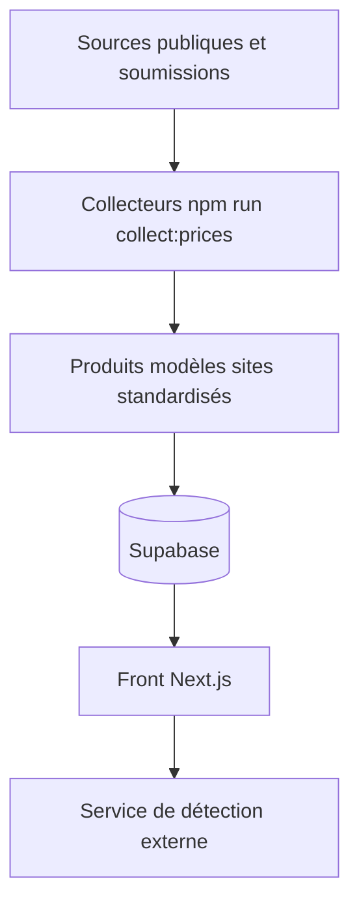

# dimthink/PriceAI

> Price comparator for AI subscriptions, official APIs and relay APIs, in Chinese.

## The problem
The price of the same subscription or API varies by channel (official, top-up card, relay), with no reliable comparison.

## What it actually does
It aggregates public or submitted prices: official subscriptions by region, over 200 card sites, official APIs (DeepSeek, Qwen, Kimi, GLM) and relay APIs with top-up coefficients. A separate detection service (a fork of veridrop, AGPL) tests a relay with a temporary key. Without Supabase, the front end displays demo data.

## How it is wired


## Trying it
```bash
npm install
npm run dev
npm run collect:prices -- --all --post
```

## Cost and gotchas
The code runs for free, but full use requires Supabase and a separate detection service. The detector receives a temporary relay API key: be careful. The project guarantees no vendor and excludes security workarounds.

## What it is not
Not a marketplace: it neither sells nor guarantees anything. It touches unofficial channels (cards, relays) at real risk to your accounts.

## Alternatives
No alternative named in the README.

## For you
Ignore: a README in Chinese, geared toward consumer purchases of subscriptions through unofficial channels, not a tool for a data/MLOps profile.
