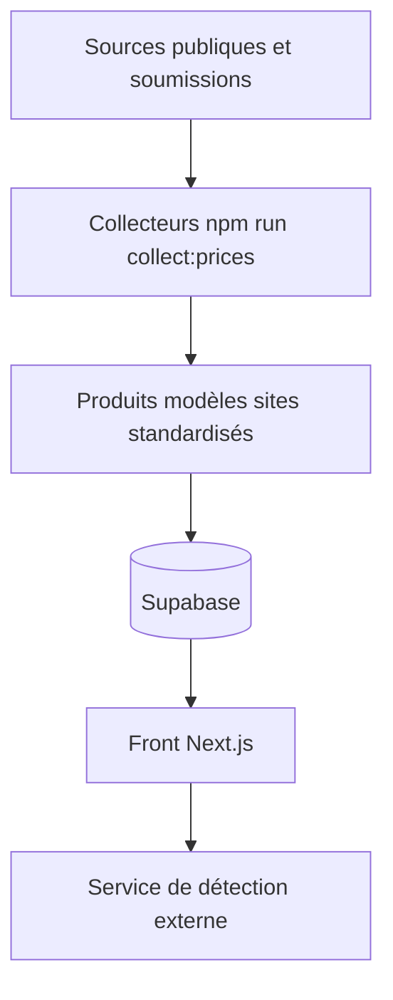

# dimthink/PriceAI

> Comparateur de prix des abonnements IA, des API officielles et des API de relais, en chinois.

## Le problème
Les prix d'un même abonnement ou API varient selon le canal (officiel, carte de recharge, relais), sans comparaison fiable.

## Ce que ça fait vraiment
Il agrège des prix publics ou soumis : abonnements officiels par région, plus de 200 sites de cartes, API officielles (DeepSeek, Qwen, Kimi, GLM) et API de relais avec coefficients de recharge. Un service de détection séparé (fork de veridrop, AGPL) teste un relais avec une clé temporaire. Sans Supabase, le front affiche des données de démonstration.

## Comment c'est branché


## Essayer
```bash
npm install
npm run dev
npm run collect:prices -- --all --post
```

## Coût et pièges
Le code se lance gratuitement, mais l'usage complet demande Supabase et un service de détection séparé. Le détecteur reçoit une clé d'API temporaire de relais : prudence. Le projet ne garantit aucun vendeur et exclut les contournements de sécurité.

## Ce que ce n'est pas
Ce n'est pas une place de marché : il ne vend ni ne garantit rien. Il touche à des canaux non officiels (cartes, relais) au risque réel pour tes comptes.

## Alternatives
Aucune alternative nommée dans le README.

## Pour toi
À ignorer : README en chinois, orienté achats grand public d'abonnements via des canaux non officiels, pas un outil pour un profil data/MLOps.

