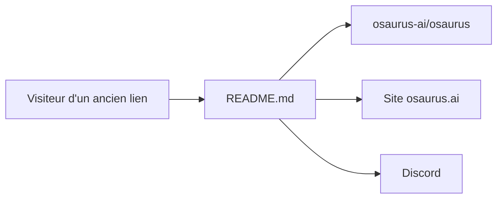

# dinoki-ai/osaurus

> Relay repository: the Osaurus project has moved to osaurus-ai/osaurus.

## The problem
Old links point to a repository that is no longer where development happens.

## What it actually does
The repository only contains a moving notice: a command to change the git remote and links to the website, the new repository, Discord and downloads. Nature of the Osaurus application: not documented here.

## How it is wired


## Trying it
```bash
git remote set-url origin https://github.com/osaurus-ai/osaurus.git
```

## Cost and gotchas
Nothing to install. No license declared, last push on February 24, 2026.

## What it is not
Not the Osaurus application or its code: only a redirect sign.

## Alternatives
osaurus-ai/osaurus: the active repository where development, issues and releases live.

## For you
Ignore: a repository with no content; if Osaurus interests you, evaluate the new repository.
