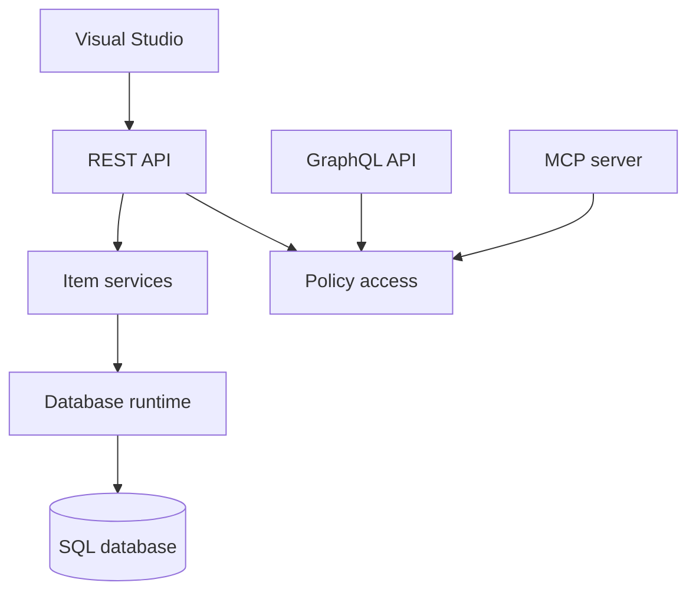

# directus/directus

> Collaborative backend that exposes an existing SQL database as a REST and GraphQL API, with a visual studio.

## The problem
Giving SQL data an API and an admin interface without coding everything.

## What it actually does
README provided: just the file name, with no content. Based on the architecture: REST and GraphQL API, policy-based permissions, item services, collections, fields, relations, data import, file storage, Vue studio, MCP server and AI assistant, extension manager.

## How it is wired

## Trying it
No command documented in the README provided.

## Cost and gotchas
Installation and cost are not documented here. A SQL database is required. A license is present but not identified by GitHub.

## What it is not
It is not an ORM nor a simple API generator: it is a backend with an interface and permissions. The detail of the endpoint-to-service connections is not established by the sampled architecture.

## Alternatives
No alternative named in the README.

## For you
Worth watching: permission-governed MCP access is interesting for agents, but the sheet lacks the material to conclude more firmly.
