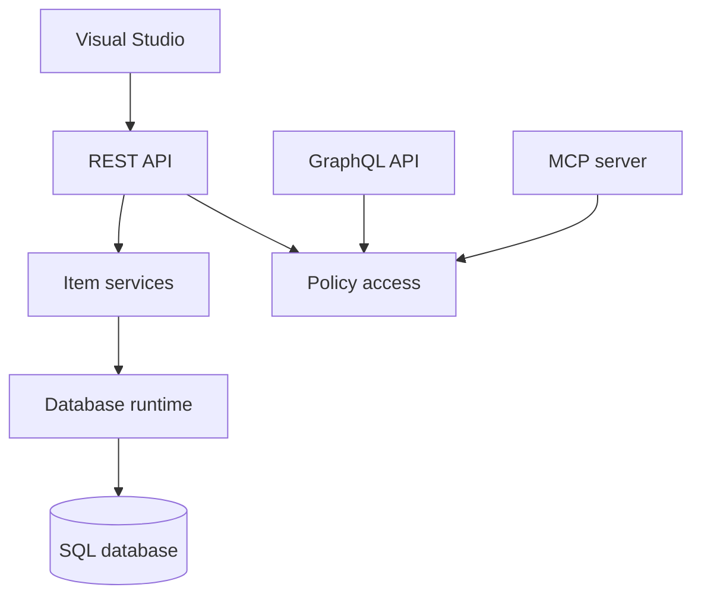

# directus/directus

> Backend collaboratif qui expose une base SQL existante en API REST et GraphQL, avec un studio visuel.

## Le problème
Donner une API et une interface d'administration à des données SQL sans tout coder.

## Ce que ça fait vraiment
README fourni : le seul nom de fichier, sans contenu. D'après l'architecture : API REST et GraphQL, permissions par politiques, services d'items, collections, champs, relations, import de données, stockage de fichiers, studio Vue, serveur MCP et assistant IA, gestionnaire d'extensions.

## Comment c'est branché

## Essayer
Aucune commande documentée dans le README fourni.

## Coût et pièges
Installation et coût non documentés ici. Une base SQL est nécessaire. Licence présente mais non identifiée par GitHub.

## Ce que ce n'est pas
Ce n'est pas un ORM ni un simple générateur d'API : c'est un backend avec interface et permissions. Le détail des connexions endpoint-service n'est pas établi par l'architecture échantillonnée.

## Alternatives
Aucune alternative nommée dans le README.

## Pour toi
À surveiller : l'accès MCP gouverné par permissions est intéressant pour des agents, mais la fiche manque de matière pour trancher mieux.

