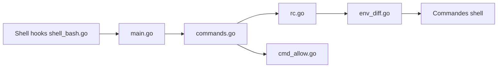

# direnv/direnv

> Shell extension that loads and unloads environment variables depending on the current directory.

## The problem
Project-specific variables pollute `.profile` or have to be exported by hand every time you change directory.

## What it actually does
Before each prompt, direnv looks for `.envrc` (and optionally `.env`) in the directory and its parents. If it is allowed (`direnv allow`), it runs it in a bash subshell, captures the exported variables, computes the difference and applies it to the current shell. Standard library (`PATH_add`…), extensions via `direnvrc`. Static executable, many shells supported.

## How it is wired


## Trying it
```bash
mkdir ~/my-project
cd ~/my-project
echo export FOO=foo > .envrc
direnv allow .
brew bundle
make test
```

## Cost and gotchas
Free. Unix only; only the environment is passed through (not aliases or functions). 468 open issues. The `.envrc` runs with your privileges: only allow it if you trust it.

## What it is not
Not a version manager or a secrets manager; it does not load into the current shell but into a subprocess.

## Alternatives
mise (direnv + make + asdf), asdf-direnv, quickenv: depending on the need for speed or tooling.

## For you
Ideal for switching API keys and virtual environments per project; adopt it.
