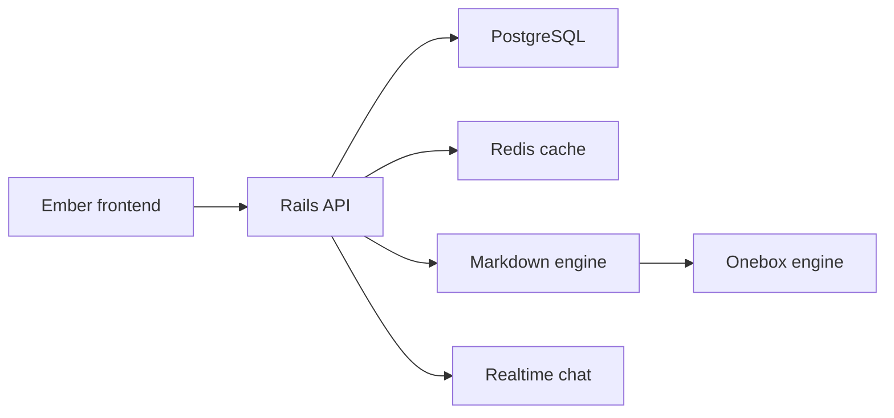

# discourse/discourse

> Open-source forum and community platform, which can be self-hosted or hosted by the vendor.

## The problem
Email lists and social media platforms are not well-suited for facilitating long, in-depth discussions within a community.

## What it actually does
Topics of discussion, responses, real-time chat, themes and plugins (Discourse AI chatbots, Data Explorer SQL), moderation. Back-end: Rails API, front-end: Ember, PostgreSQL, Redis. Rendering uses a Markdown engine and Onebox for links.

## How it is wired


## Trying it
```bash
wget -qO- https://raw.githubusercontent.com/discourse/discourse_docker/main/install-discourse | sudo bash
```

## Cost and gotchas
Free self-hosting (Ruby 3.4+, PostgreSQL 15, Redis 7) or official hosting with a free plan and paid options. Requires a server and maintenance time.

## What it is not
Not a data/AI tool. GPL-2.0: Redistribution requires sharing of modified versions.

## Alternatives
No alternative is specified in the README file.

## For you
Things to avoid: community forums that are unrelated to data/AI, unless you are creating a support community.
