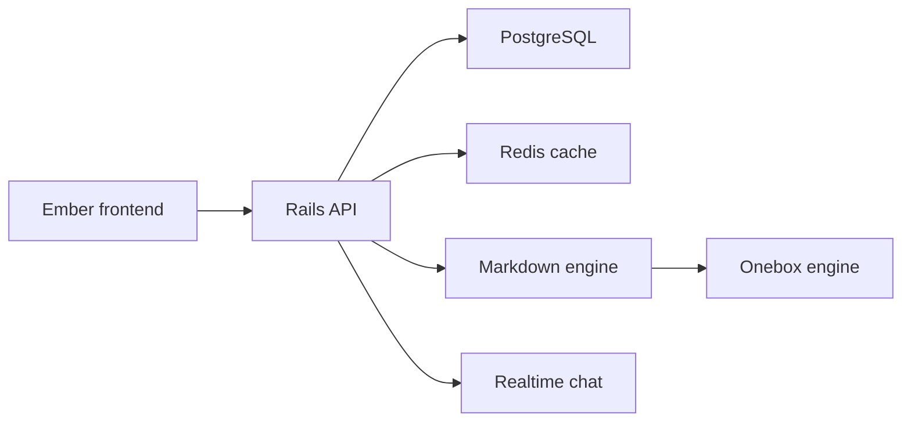

# discourse/discourse

> Plateforme de forum et de communauté open source, auto-hébergeable ou hébergée par l'éditeur.

## Le problème
Les listes de diffusion et réseaux sociaux ne structurent pas bien des discussions longues et durables au sein d'une communauté.

## Ce que ça fait vraiment
Sujets de discussion, réponses, chat temps réel, thèmes et plugins (chatbots Discourse AI, Data Explorer SQL), modération. Back-end Rails API, front Ember, PostgreSQL, Redis. Le rendu passe par un moteur Markdown et Onebox pour les liens.

## Comment c'est branché


## Essayer
```bash
wget -qO- https://raw.githubusercontent.com/discourse/discourse_docker/main/install-discourse | sudo bash
```

## Coût et pièges
Auto-hébergement gratuit (Ruby 3.4+, PostgreSQL 15, Redis 7) ou hébergement officiel avec plan gratuit et formules payantes. Il faut un serveur et du temps de maintenance.

## Ce que ce n'est pas
Pas un outil data/IA. GPL-2.0 : obligations de partage en cas de redistribution modifiée.

## Alternatives
Aucune alternative nommée dans le README.

## Pour toi
À ignorer : forum communautaire sans rapport avec la data/IA, sauf si tu montes une communauté de support.

