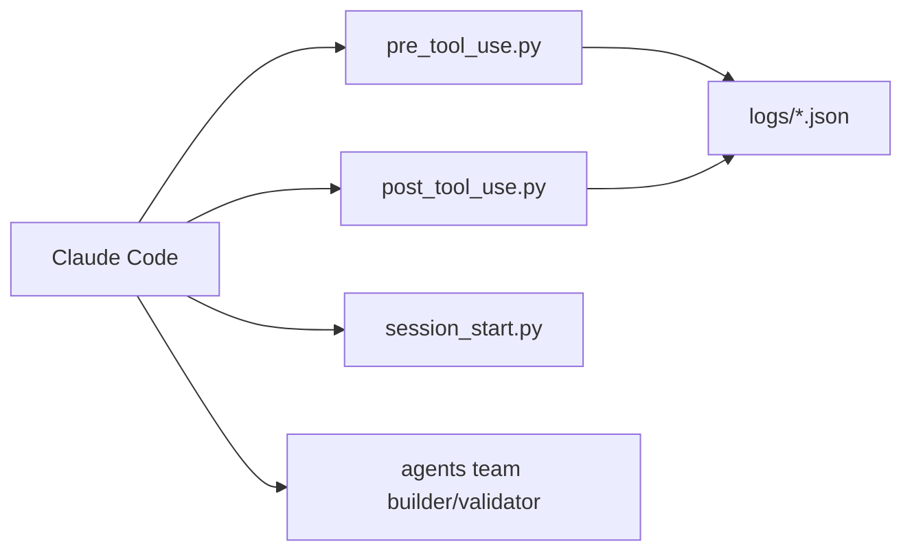

# disler/claude-code-hooks-mastery

> Educational repository that demonstrates Claude Code's 13 hooks, sub-agents and team validation.

## The problem
Controlling Claude Code's behavior deterministically (blocking commands, logging, injecting context) requires understanding hooks.

## What it actually does
Provides single-file Python scripts run by `uv` for each event (UserPromptSubmit, PreToolUse, PostToolUse, Stop, SessionStart…), which log in JSON and can block via exit code 2. Adds sub-agents (meta-agent, builder/validator), ten output styles, nine status lines, commands like `/plan_w_team` and optional TTS (ElevenLabs, OpenAI, Ollama). The internal hooks were not read in the code analysis.

## How it is wired


## Trying it
```bash
uv run $CLAUDE_PROJECT_DIR/.claude/hooks/user_prompt_submit.py --log-only
cat logs/user_prompt_submit.json | jq '.'
```
Configuration command shown in `.claude/settings.json`.

## Cost and gotchas
Free; requires `uv` and Claude Code. TTS and agent names use optional third-party keys. The Stop hook that forces continuation can loop. No license declared: reuse needs to be clarified.

## What it is not
Not an installable library: examples to copy and adapt. The repository also contains a Bun task manager with no direct relation to hooks.

## Alternatives
No alternative cited in the README.

## For you
Worth watching: a concrete reference for your own hooks and guardrails, to read rather than clone as is given the lack of a license.
