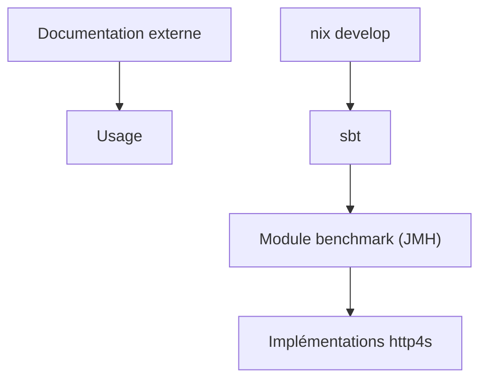

# disneystreaming/smithy4s

> Scala code generation from Smithy models; the README does not say so itself and points to its documentation.

## The problem
The README does not present the problem: it points to external documentation and only covers development.

## What it actually does
The README does not describe the tool. It contains only development notes: a benchmarks module comparing generic implementations to hand-written http4s versions, a Nix environment, settings for Metals/Bloop and `.sbtopts`. The name evokes Smithy and Scala, but the rest is not documented here.

## How it is wired
Simplified diagram based on the sheet, no diagram provided.


## Trying it
```bash
sbt benchmark / Jmh / run
benchmark / Jmh / run .*Http4sBenchmark.*
nix develop
cp .sbtopts.example .sbtopts
```

## Cost and gotchas
Free. Requires Scala and sbt (not in the prerequisites list), with a heavy compilation matrix and more memory for sbt. License present but not identified by GitHub.

## What it is not
Not a usage guide: the README does not say what the tool is for.

## Alternatives
- http4s: hand-written implementations, used for the performance comparisons.

## For you
Ignore: Scala and Smithy ecosystem unrelated to your data / AI stack, and the README is too thin to judge.
