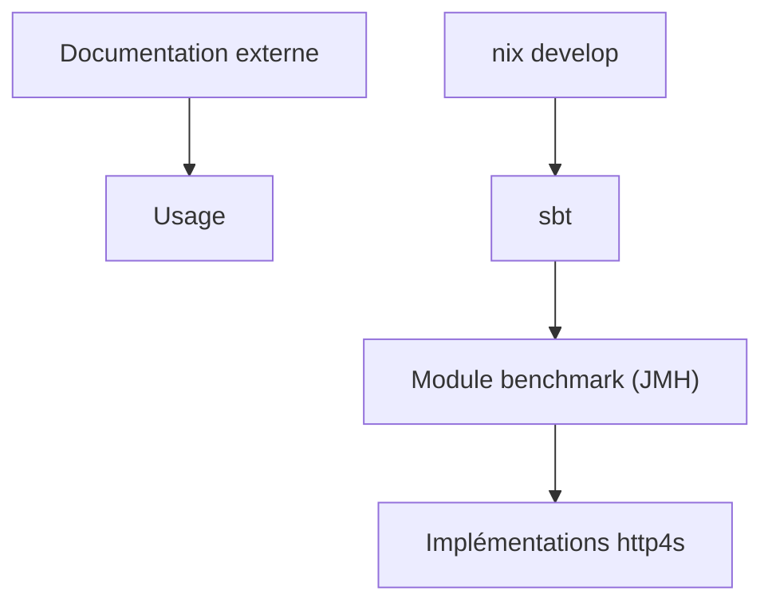

# disneystreaming/smithy4s

> Génération de code Scala à partir de modèles Smithy ; le README ne le dit pas lui-même et renvoie à sa documentation.

## Le problème
Le README ne présente pas le problème : il renvoie à une documentation externe et ne parle que du développement.

## Ce que ça fait vraiment
Le README ne décrit pas l'outil. Il ne contient que des notes de développement : un module de benchmarks comparant les implémentations génériques à des versions http4s écrites à la main, un environnement Nix, des réglages pour Metals/Bloop et `.sbtopts`. Le nom évoque Smithy et Scala, mais le reste n'est pas documenté ici.

## Comment c'est branché
Schéma simplifié d'après la fiche, sans diagramme fourni.


## Essayer
```bash
sbt benchmark / Jmh / run
benchmark / Jmh / run .*Http4sBenchmark.*
nix develop
cp .sbtopts.example .sbtopts
```

## Coût et pièges
Gratuit. Il faut Scala et sbt (hors liste de prérequis), avec une matrice de compilation lourde et plus de mémoire pour sbt. Licence présente mais non identifiée par GitHub.

## Ce que ce n'est pas
Ce n'est pas un guide d'usage : le README ne dit pas à quoi sert l'outil.

## Alternatives
- http4s : implémentations écrites à la main, utilisées pour les comparaisons de performance.

## Pour toi
À ignorer : écosystème Scala et Smithy sans lien avec ta pile data / IA, et README trop pauvre pour juger.

