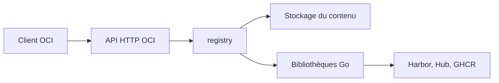

# distribution/distribution

> Reference implementation of the OCI registry, foundation of container image registries.

## The problem
Storing and distributing container images without depending on a public registry requires a faithful implementation of the OCI Distribution spec, one that is safe and able to handle the load.

## What it actually does
Provides the `registry` binary, an implementation of the OCI Distribution Specification, plus a set of Go libraries to talk to its components (interfaces declared **unstable**). Clients speak HTTP according to the spec. The project is the basis of Docker Hub, GitHub Container Registry, GitLab Container Registry, DigitalOcean Container Registry and Harbor (CNCF as well as VMware).

## How it is wired

## Trying it
No installation command is documented in this README; the full documentation points to https://distribution.github.io/distribution.

## Cost and gotchas
Free, but it is an infrastructure building block: storage, TLS, authentication and monitoring remain your responsibility. The bundled Go client is **deprecated** in favor of containerd's.

## What it is not
Not a turnkey product with an interface: Harbor plays that role on top of it.
Not a stable API on the library side. No license stated in this README.

## Alternatives
- **Harbor**: full registry (UI, scanning, replication) built on this foundation.
- **containerd**: its client implementation replaces the deprecated one from here.

## For you
Useful to know if you set up a private registry for your model images; otherwise go with Harbor.
