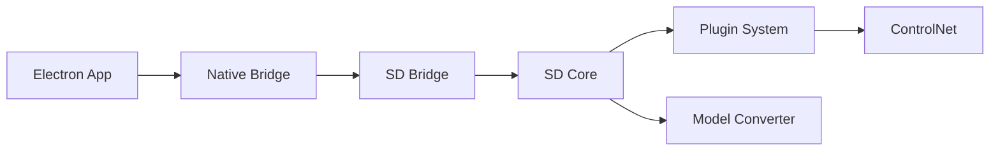

# divamgupta/diffusionbee-stable-diffusion-ui

> One-click macOS application to run Stable Diffusion locally.

## The problem
Installing Stable Diffusion locally on a Mac means managing Python, dependencies and weights.

## What it actually does
Electron interface, single installer, local processing.
Text→image, image→image, inpainting, outpainting, upscaling, ControlNet, LoRA; SD 1.x, 2.x, XL.
Model downloads from within the app, generation history, optimized for M1/M2.

## How it is wired

## Trying it
No command documented: download from diffusionbee.com.

## Cost and gotchas
Free; macOS 11+ (M1/M2) or 12.3.1+ (Intel). Outputs are subject to the CreativeML OpenRAIL-M license.

## What it is not
Not a library nor an API; last push October 2024, recent models probably absent.

## Alternatives
No alternative named; the README cites its foundations (CompVis/stable-diffusion, huggingface/diffusers).

## For you
Ignore: aging consumer macOS tool, diffusers is the way for programmatic use.
