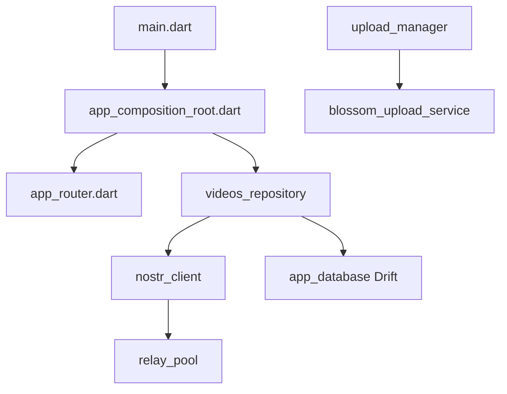

# divinevideo/divine-mobile

> Flutter app for 6-second short videos, decentralized on Nostr, with no AI-generated content.

## The problem
Short-video networks keep control over the content, the followers and the usernames.

## What it actually does
Built-in camera and editor, infinite feed, follows, encrypted messages, notifications and C2PA provenance. Identities sign on Nostr, media is hosted on Blossom, and the local Drift database is encrypted. The architecture follows UI, BLoC, repository, then client, with a migration away from Riverpod under way.

## How it is wired


## Trying it
```bash
cd mobile
flutter pub get
flutter run -d <device>
flutter analyze
flutter test
```

## Cost and gotchas
Free. Requires Flutter 3.47 and Dart 3.13. The local Docker stack is only turnkey on an Android emulator. Firebase, Zendesk and ProofMode need keys that are not in the repo. 660 open issues.

## What it is not
Not a reusable library: a full application. The repo also contains a Cloudflare worker for the app directory.

## Alternatives
No alternative named in the README.

## For you
Ignore: a consumer app with no link to data, AI or MLOps work.
