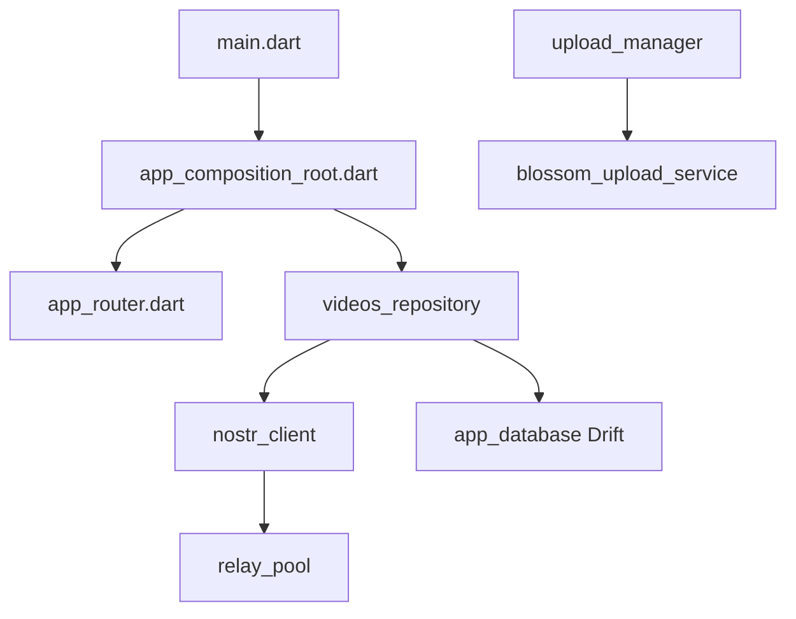

# divinevideo/divine-mobile

> Application Flutter de vidéos courtes de 6 secondes, décentralisée sur Nostr, sans contenu généré par IA.

## Le problème
Les réseaux de vidéos courtes gardent la main sur les contenus, les abonnés et les noms d'utilisateur.

## Ce que ça fait vraiment
Caméra et éditeur intégrés, fil infini, abonnements, messages chiffrés, notifications et provenance C2PA. Les identités signent sur Nostr, les médias sont hébergés sur Blossom, la base locale Drift est chiffrée. L'architecture suit UI, BLoC, dépôt puis client, avec une migration depuis Riverpod en cours.

## Comment c'est branché


## Essayer
```bash
cd mobile
flutter pub get
flutter run -d <device>
flutter analyze
flutter test
```

## Coût et pièges
Gratuit. Flutter 3.47 et Dart 3.13 requis. La pile locale Docker n'est turnkey que sur émulateur Android. Firebase, Zendesk et ProofMode demandent des clés hors dépôt. 660 issues ouvertes.

## Ce que ce n'est pas
Pas une bibliothèque réutilisable : une application complète. Le dépôt contient aussi un worker Cloudflare pour l'annuaire d'applications.

## Alternatives
Aucune alternative nommée dans le README.

## Pour toi
À ignorer : une application grand public sans lien avec un travail data, IA ou MLOps.

