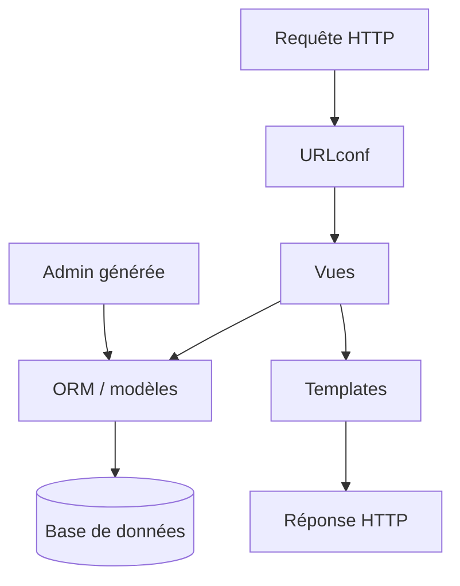

# django/django

> A high-level Python web framework, focused on rapid development and pragmatic design.

## The problem
Building a complete web application requires rebuilding ORM (Object-Relational Mapping), routing, templates, admin, authentication, and migrations.
Assembling these components one by one takes a significant amount of time and can lead to inconsistent choices.

## What it actually does
Provides the entire package in a single distribution, with documentation available in the `docs/` directory and online.
The README is intentionally minimal: it directs users to the installation instructions, tutorials, thematic guides, and reference materials.
The recommended workflow is clearly defined: `docs/intro/install.txt`, followed by the tutorials in order, and then `docs/topics`.
A complete set of tests is described in `docs/internals/contributing/writing-code/unit-tests.txt`.

## How it is wired

## Trying it
There is no command specified in the README; it refers to `docs/intro/install.txt`.

## Cost and gotchas
Free and open-source. The actual cost is the time required to learn and use a large, opinionated framework.

The Django Software Foundation relies on donations – as explicitly stated in the README.

## What it is not
Not a micro-framework: the conventions are strict and difficult to circumvent partially.
Not designed for asynchronous, real-time API usage by default, nor for serving models.
The README does not document anything itself: all the documentation is in the `docs/` directory.

## Alternatives
None are listed in the README.

## For you
The best choice is to use a framework as soon as a data project requires a real web application with administration and authentication features.
