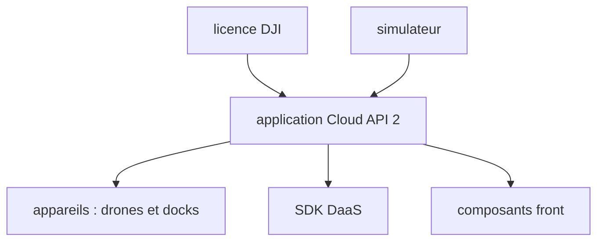

# dji-sdk/Cloud-API-2

> DJI's open platform for integrating drones and docks: SDK, components, simulator and demos.

## The problem
Integrating DJI drones into business software forces you to reimplement the cloud communication protocol.

## What it actually does
Provides an object-oriented DaaS SDK, front-end components (cockpit, route editor, flight logs), a device simulator, an AI plugin and demos. Features covered: device management, live video, remote control, media, routes and missions. Free usage license to be requested.

## How it is wired
Simplified diagram based on the sheet, no diagram provided.

## Trying it
README steps: request the license, deploy the application, connect the devices, configure authentication, integrate components then the SDK. No command provided.

## Cost and gotchas
Free but the license must be requested on the DJI developer platform, with verified identity for the workshops. README in Chinese; main code hosted outside the repository (downloads).

## What it is not
Not a standalone product: it presupposes DJI hardware or its simulator.

## Alternatives
No alternative named.

## For you
Ignore: drone integration, outside data/AI/MLOps.
